

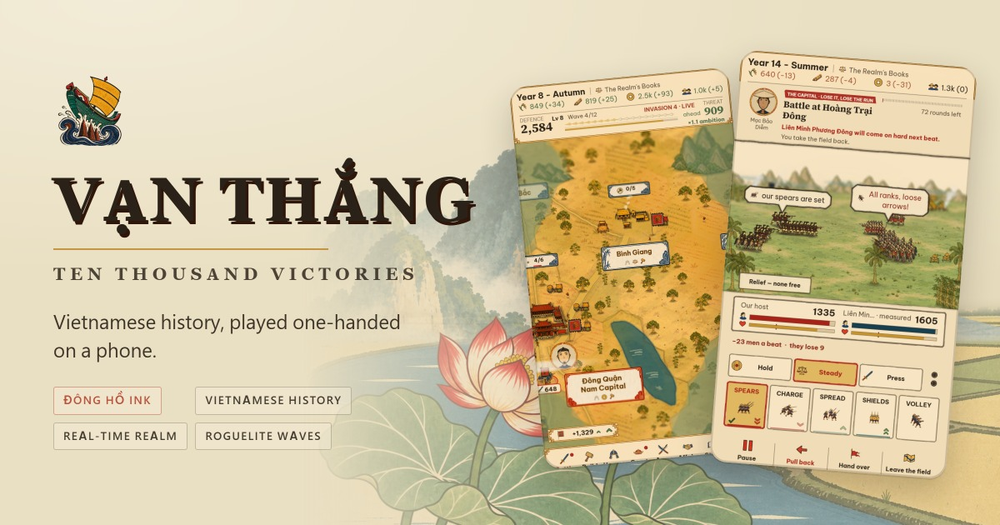

# Vạn Thắng

### *Ten Thousand Victories*

### Vietnamese history, played one-handed on a phone.

**A grand-strategy roguelite drawn like a Đông Hồ woodblock print. Free, with no ads, in English and Tiếng Việt.**

**[🇻🇳 Đọc trang này bằng tiếng Việt](README.vi.md)**

 

Add it to your home screen from the browser and it plays offline and full screen, with no store and no account.

Or support the developer with the donate version on Google Play or the App Store: 50,000₫ (≈ US$2), paid once.

&nbsp;

 

<table>
  <tr>
    <td align="center" width="30%">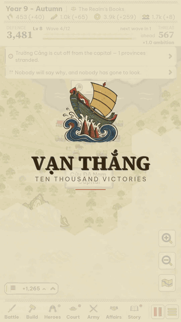 <b>On a phone</b>: one column, one thumb</td>
    <td align="center" width="70%">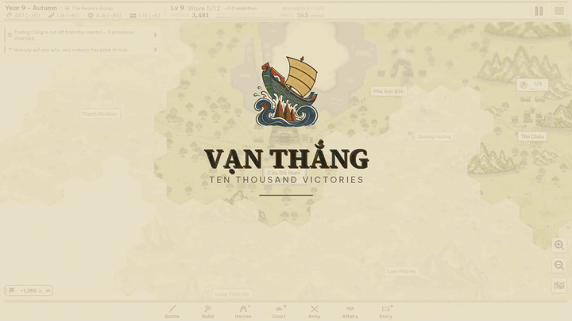 <b>On a desktop</b>: the map fills the window</td>
  </tr>
</table>

Twenty-five seconds of a real run, cut twice because the game has two layouts. Every frame comes from the game being played. <a href="README.vi.md">Bản tiếng Việt</a> has its own cuts.

 

> **Play free in your browser:** Dragon Ascent and the Skirmish, ten stories of the Chronicle, a reign to the third Great Invasion, and a first valley of Story Mode. Buy the donate version on [Google Play](https://play.google.com/store/apps/details?id=zrg.team.vanthang) or the [App Store](https://apps.apple.com/app/id6805950974) to support the game.

---

## 📑 Contents

- [🎯 Why this exists](#-why-this-exists)
- [🐉 How it plays: Dragon Ascent · Rồng Thăng Long](#-how-it-plays-dragon-ascent--rồng-thăng-long)
- [🌾 The economy: what the realm runs on](#-the-economy-what-the-realm-runs-on)
- [🎎 The heroes: a court worth paying](#-the-heroes-a-court-worth-paying)
- [🥁 The fight screen: five shapes and a drum](#-the-fight-screen-five-shapes-and-a-drum)
  - [The armies on the field](#the-armies-on-the-field)
- [📜 The Chronicle: history told with your own heroes](#-the-chronicle-history-told-with-your-own-heroes)
- [🏮 The real history, one tap deep](#-the-real-history-one-tap-deep)
- [🖌️ A graphic perspective](#️-a-graphic-perspective)
  - [The cards: fifty prints, one for each power](#the-cards-fifty-prints-one-for-each-power)
  - [The heroes](#the-heroes)
  - [The armies of the kingdoms](#the-armies-of-the-kingdoms)
  - [Đông Hồ](#đông-hồ)
- [📱 Play](#-play)
- [🤝 Help improve the game](#-help-improve-the-game)
- [📄 License](#-license)
- [☕ Support](#-support)
- [🙏 Credits](#-credits)

## 🎯 Why this exists

Every Vietnamese child grows up with the same stories: the boy who played war with reed banners and became an emperor; the divine crossbow and the goose feathers that betrayed it; the stakes hidden in the Bạch Đằng river; the elders at Diên Hồng who answered *fight*; the boy who crushed an orange in his fist because he was too young to be let into the council.

Outside Việt Nam almost nobody knows them. Inside, they arrive as paragraphs in a textbook.

**Vạn Thắng** tries to make that history *playable*. Yết Kiêu the diver, Lê Lai's borrowed coat and the Temple of Literature turn up as decisions on your screen, in a game good enough to play for its own sake. It is made for the phone in your pocket, in both languages as equals, and it is free.

## 🐉 How it plays: Dragon Ascent · *Rồng Thăng Long*

You are a small lord with one citadel on a map of forty-two provinces, generated fresh for every run. **The realm runs itself; you choose its power.** The clock runs in real time, so the country keeps ticking while you look away, and every choice arrives as a card you answer with a thumb.

- **Waves.** Every year and a half an invading host arrives, bigger than the last. Every fourth is a boss, announced a season ahead. There is no winning screen: a run is measured by how many waves you survive.
- **Ambition.** Every province you take, card you draft and host you raise makes the next wave stronger.
- **Power draft.** Each level offers four cards (bronze, silver, gold, jade), and the one you pick stacks for the rest of the reign. Two maxed cards can *evolve* into a new one. There are fifty-two, and [each has its own woodblock print](#the-cards-fifty-prints-one-for-each-power).
- **Doctrine.** Once an era you tell your ministers what kind of realm this is (*Fortify*, *Expand*, *Enrich* or *Arm*), and the autopilot builds toward it until you change your mind.
- **Legacy.** The end of a run banks Legacy, which buys permanent perks for the next one.

<table>
  <tr>
    <td align="center" width="33%">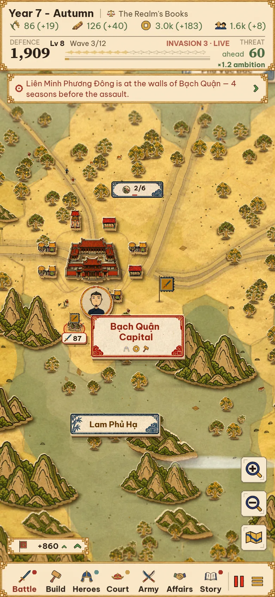 The realm, mid-run</td>
    <td align="center" width="33%">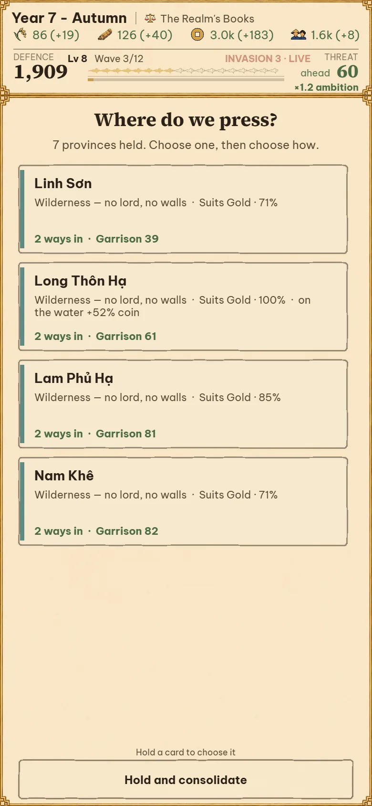 Where do we press?</td>
    <td align="center" width="33%">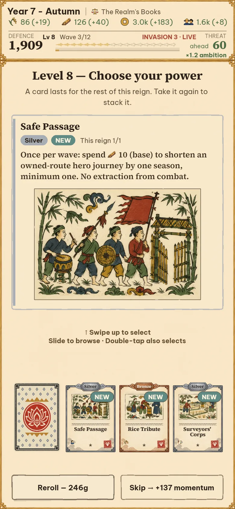 Choose your power</td>
  </tr>
</table>

Under that loop sit four systems: an economy, a court of heroes, a battle screen and a story engine. The rest of this page covers each one and why it works the way it does.

## 🌾 The economy: what the realm runs on

<table>
  <tr>
    <td valign="top">

Four resources, **food, supplies, gold and humans**, come from the provinces, and each province yields what its hexes hold: paddies and rivers feed, hills and mountains arm, ports trade. Seasons move the harvest (autumn ×1.25, winter ×0.8). Armies eat rations, burn provisions on the march and desert when they starve. Heroes draw wages. Income past five hundred gold meets diminishing returns, and a hoard past four thousand starts leaking to graft; the advisor tells you how much of it rots this season.

**You steer it by building.** Each province holds a few works, and what you raise decides what the realm can do: walls buy defence, farms buy time, markets pay for the next summon. Work takes seasons. The claims row at the top limits expansion as well, because the realm can court only so many provinces at once, and the court asks you about any province within reach before it spends a coin on it.

A roguelite about expansion needs a brake, and a countdown timer would be a dull one. Here the economy is the brake: every province taken and every host raised feeds Ambition, which sizes the next wave, so each thing you build is also a bet on how much heat you can take. The numbers on screen, such as the odds on a card or the rot on the hoard, come from the same code that resolves them, so what the screen tells you is what will happen.

</td>
    <td width="38%">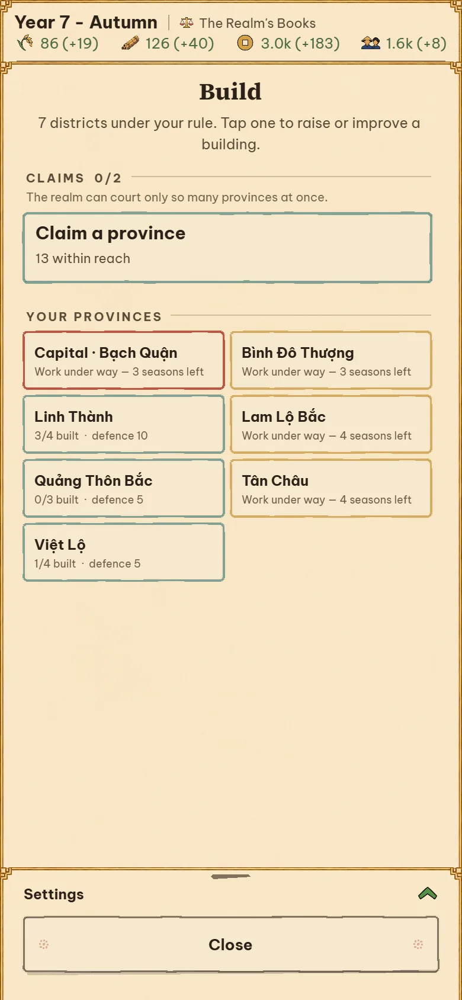</td>
  </tr>
</table>

## 🎎 The heroes: a court worth paying

<table>
  <tr>
    <td width="38%">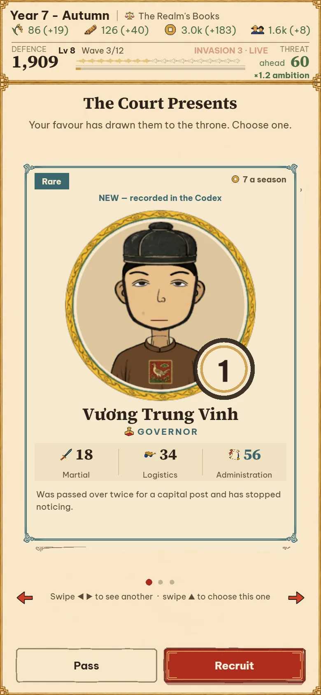</td>
    <td valign="top">

Champions arrive by **summon**, a gacha with pity (*three answer the call, one will serve*), or by draft once your court has enough Favor. Each has six stats (martial, logistics, administration, diplomacy, loyalty, renown), a wage the treasury pays every season, a line of character worth reading and a portrait. The first time you meet one, the Codex records them for good.

Heroes govern provinces, carry missions and, above all, *command*. The general on the battle plate moves the odds, and a host with no general fights like it. They also have lives of their own: two rivals start eating together, someone asks for a command, someone walks out. The Chronicle casts its stories from these same people, so the general in your next legend is the one you summoned, paid and nearly lost.

The history this game cares about is about people, so each run needs a cast that things can happen *to*. The gacha gives each run different company, wages tie the court to the economy, and the stats make "who leads?" a real decision.

</td>
  </tr>
</table>

Each portrait is put together from a library of **277 drawn parts**: heads, hair, hats, collars, robes and marks. **Who the person is** (era, office, rank, sex, vows) decides the wardrobe first, and only then does a seed pick within it, so an official of the Lê court never wears a Nguyễn collar and a general in the field never wears a scholar's cap. The roster has 127 champions, and many of them were real people:

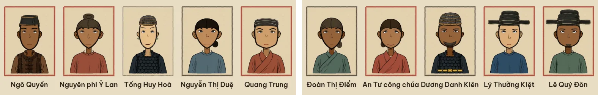

## 🥁 The fight screen: five shapes and a drum

<table>
  <tr>
    <td valign="top">

A fight worth watching opens on its own: both hosts form up, the drum counts five, and from then on you read the field. Every battle uses **five shapes**, *thế*, the postures an army takes: **Chông** the hedge of spears, **Xung** the wedge, **Tán** the loose swarm, **Quy** the tortoise and **Nỏ** the massed volley. Each beats the two that follow it round the ring:

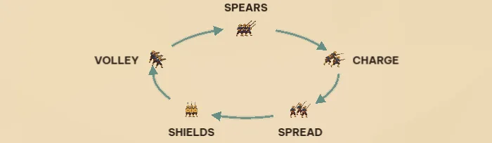

Words over the enemy line say what they hold and what they are re-forming into (*their spears are set*, *they form Quy · 3*), and you answer. Above the shapes sits a **tempo dial** that runs from *pull back* to *press*. It sets how fast men are spent and multiplies your read: lean on the right shape and you win bigger, lean on the wrong one and you bleed faster. **Dồn sức** bets a second pip on the shape you already hold, the **reserve** can be committed once, and you can send for relief. You can also hand the fight to your generals. They do a fair job, though never as good a one as you would.

Micromanaging units does not work on a phone held in one hand, so each fight comes down to one question asked against a clock: *what are they holding, and what answers it?* Everything you need to answer it reads at arm's length. The fight also belongs to the run. The hosts are the ones your economy raised, the commander is the hero you paid, and the outcome moves the ground you hold, your momentum and the strength of the next wave.

</td>
    <td width="38%">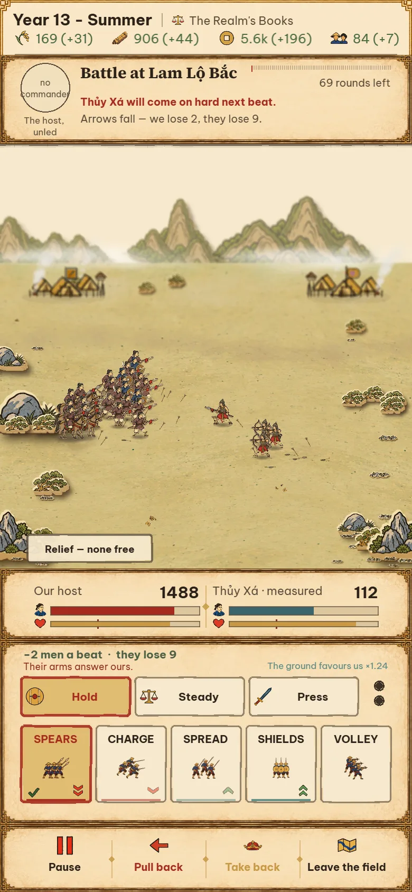</td>
  </tr>
</table>

### The armies on the field

Each host is drawn as ranks of figures standing in the shape it actually holds (spears two deep, horse gathered at the point, shields locked), under its own banner with its camp behind it, in the same procedural ink that draws the paddies and the citadels. What you read at a glance, *their line is still forming, ours is a set hedge*, is the actual state of the fight:

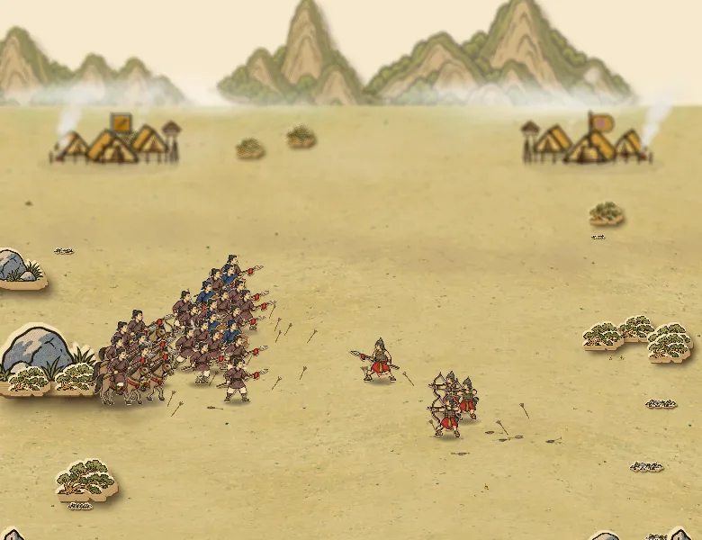

Every man is his own figure, so a host moves like an army. A wing of horse rides out, hits a hedge of spears and is thrown back in its own dust; the lines close and press; a host that breaks runs off man by man instead of vanishing:

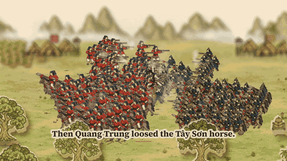 The Tây Sơn horse breaking the Qing line at Đống Đa, staged in the game's own battle engine

## 📜 The Chronicle: history told with your own heroes

The Chronicle holds **forty-nine story templates**. When the moment fits, a story binds itself to *your* heroes and *your* provinces and arrives as a whisper on the map, a card in your hand or a blow that changes the run. Each one is a piece of Vietnamese history or legend, told at the length a run has room for.

<table>
  <tr>
    <td width="40%">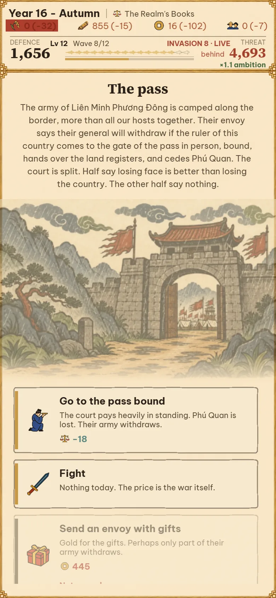</td>
    <td valign="top">

**A few of the pages**

- *Ngọn Cờ Lau* · The Reed Banner (Đinh Bộ Lĩnh)
- *Nỏ Thần* · The Divine Crossbow, and *Lông Ngỗng*, the goose feathers
- *Cọc Bạch Đằng* · The Stakes in the River
- *Hội Nghị Diên Hồng* · The Elders Answer
- *Quả Cam* · The Orange (Trần Quốc Toản)
- *Nam Quốc Sơn Hà* · The Mountains and Rivers of the Southern Land
- *Bình Ngô Đại Cáo* · The Great Proclamation
- *Hai Bà Trưng* · The Trưng Sisters, and *Sáu Mươi Lăm Thành*
- *Lê Lai Đổi Áo* · The Substitution
- *Hồ Gươm* · The Lake of the Returned Sword
- *Yết Kiêu* · The Diver · *Ải Chi Lăng* · *Thần Tốc* · *Văn Miếu* · *Thánh Gióng* · *Sơn Tinh Thủy Tinh* …

A story plays with the run's own pieces. It casts the general you summoned and the province you hold, its choices spend your gold and your men, and when it resolves the card lists what changed: *−400 able men, −60 gold, the story turns toward a command*. Some stories ask you to **swear a charge**, such as holding a province or keeping the peace, and remember whether you kept it. Some leave **echoes** in the browser, so a hero who walked out on you in one run can be named in the next. Sixteen of the beats arrive under [a print of their own](#the-cards-fifty-prints-one-for-each-power), the moment the story turns on cut as a woodblock.

The stories are the point of the whole project, and a story you can skip teaches nothing. Tying each one to the run's heroes, land and treasury makes the history something that *happens to you*. Every telling is labelled: *chính sử* is what the annals record, *dã sử* is what people tell, and *ngoại truyện* is this game's own invention. All of it goes into a Chronicle you can read back at the end.

</td>
  </tr>
</table>

## 🏮 The real history, one tap deep

<table>
  <tr>
    <td valign="top">

The game dramatises, and the **History** page, one tap from the front page, does not. It sets out *what actually happened, and what this game made of it*, in five tabs in both languages: the dynasties in order, the people with their portraits and dates, each Chronicle story set against the record, how each era's armies fought, and the terms a newcomer meets. A curious player can lose an hour in it.

The game also teaches itself, with a **How to Play** page, guided tours of the first run, and an advisor strip that reads *your* live run and says what it would do next. Where most strategy games hand you a wall of numbers, this one gives you advice.

</td>
    <td width="38%">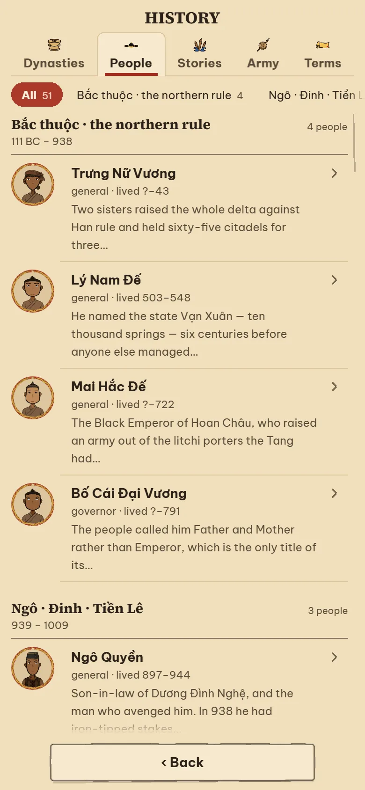</td>
  </tr>
</table>

## 🖌️ A graphic perspective

Everything above is drawn two ways, both in the manner of a **Đông Hồ folk woodblock print**. **Plates** are drawn ahead of time to a written rule sheet: one warm-black contour, flat pigment blocks, shallow symbolic space, shell-coated paper. **Ink** is drawn by code at run time to the same rules, because a country generated fresh for every run cannot be painted in advance. You should not be able to see where one stops and the other starts.

| Drawn ahead, as plates | Drawn by code, at run time |
|---|---|
| **50** card prints, one for every power card, plus 12 settings | the **country** itself: hexes, paddies, rivers, roads, fog, laid out fresh every run |
| **325** map plates: soldiers by realm and rank, roofs, trees, carts, buffalo | **4 seasons** on that same ground: the leaves turn, the paddies flood and are cut |
| **277** portrait parts: heads, hair, hats, collars, robes, rank marks | **5 shapes** a host can stand in, each drawn as the host actually holds it |

### The cards: fifty prints, one for each power

Each of the fifty power cards carries its own scene, cut to the same rule sheet: the stakes going into the Bạch Đằng, the Trưng sisters and their elephant, the pass at Chi Lăng, the armourer's crossbow, the boys admitted at the Temple of Literature, the grain fleet at Vân Đồn:

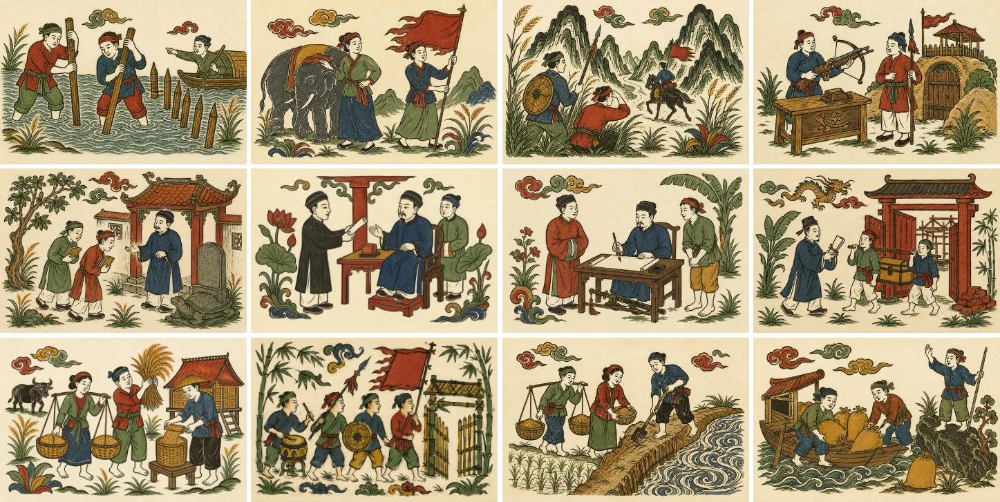

<table>
  <tr>
    <td valign="top">

The same print turns up wherever its idea does: on the card you draft mid-run, on the Chronicle beat that tells its story, in the sheet a minister hands you. All of them gather in the **Dynasty Deck**, the one collection that outlives a run. The end of every reign and every tenth wave pays a draw, and a card you draw is yours for good. Three copies fold into a stronger one, and up to three cards ride into the next reign's opening hand. You pay for them in ambition, so the enemy answers your head start.

A roguelite's power cards are usually a wall of icons, and icons are hard to remember. Here every card is a picture of what it does, drawn in the tradition the game is about, so a player who cannot yet read *Nỏ Thần* still knows which card is the crossbow, and the collection is worth opening just to look at.

</td>
    <td width="38%">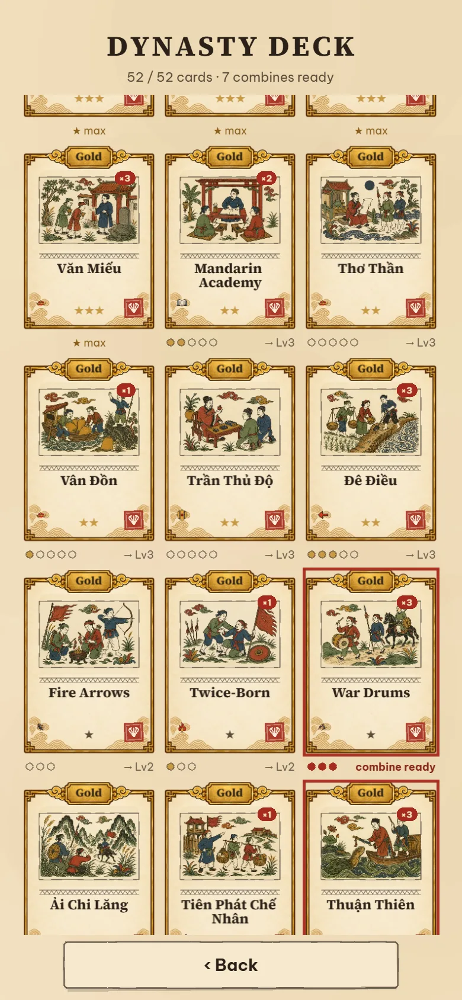</td>
  </tr>
</table>

### The heroes

These ten champions are in no roster. The generator invents the person (name, era, office), and the wardrobe dresses them by who they are, from the same **277 drawn parts** that dress the real figures above. No two courts look alike:

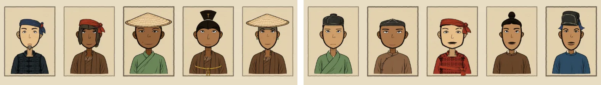

### The armies of the kingdoms

Every realm's host is built from one set of figures (the ranks, the standard riding with them, the camp behind) and stands in the shape it actually holds. The men stay in plain ink on purpose. Painting a rival's ranks in its banner colour made every garrison the loudest thing on the map, so the standard shows who owns a host and the soldiers stay ink. Five realms from one run, in five shapes:

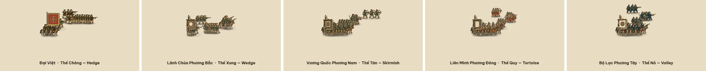

### Đông Hồ

The print itself: shell-coated điệp paper, a colour block pulled first and a soot-black contour pulled second, never quite in register, in a palette of real pigments (điệp, mực, sỏi son, chàm, gỉ đồng, hoè, nâu). The saturated red is kept for the player alone. The seasons change the ground itself: the leaves turn, the paddies flood, ripen and are cut, and the winter is bare. Here is the same square of country four times a year:

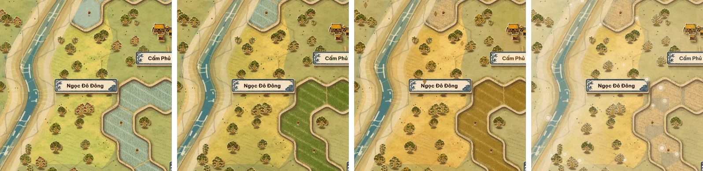

## 📱 Play

**[▶ zrg-team.github.io/ten-thousand-victories](https://zrg-team.github.io/ten-thousand-victories/)**: no install and no account, and nothing leaves your device.

- Built for a **portrait phone in one hand**. On a **computer** (anything with a mouse, or the Steam build) the game plays by desktop rules: keys for the bar (`1`–`7`), `Space` to pause, `Esc` to close, the wheel to zoom, `WASD` to pan, and new runs start on the hands-on rule (the mandate card and the run menu turn it off). In a landscape window the map takes the whole window, with the controls in a column at its right edge; a portrait window keeps the phone column. **Settings → Layout** shows which one is on and can pin either.
- **Installs** from the browser menu and **plays offline**, through a hand-written service worker.
- **Drag** to pan, **+ / −** to zoom, **tap** a province, **tap** a card to answer it.
- **English / Tiếng Việt** in Settings, along with graphics quality and the map theme.
- One save slot, kept in your browser.

**The donate version.** [**Google Play**](https://play.google.com/store/apps/details?id=zrg.team.vanthang) and the [**App Store**](https://apps.apple.com/app/id6805950974) carry the donate version for about 50,000₫ (≈ US$2), paid once. It has no ads, no in-app purchases and no account, and it plays with the network off. Buying it is how you support the work. A **Steam** build (Windows, macOS, Linux, Steam Deck) is packaged from the same code in `apps/desktop` and is on its way to the store.

## 🤝 Help improve the game

This repository holds the published game, the same files your browser plays. The source is kept private, so there is nothing here to send a pull request to, but **issues are open and read**. The most useful things you can bring, in order:

1. **Play it and say what was confusing.** A screenshot and a sentence is enough.
2. **History.** If a story is told wrong, a name is spelt wrong, or a detail would make a Vietnamese reader wince, please open an issue. The stories are dramatised, but they should never be *false*.
3. **Vietnamese copy.** Both languages are meant to be equals. Where the Vietnamese reads like a translation, it should be rewritten rather than patched.

[Open an issue](https://github.com/zrg-team/ten-thousand-victories/issues), or write to zerglingno2@outlook.com.

## 📄 License

**[PolyForm Noncommercial 1.0.0](LICENSE)**: use it for anything except making money from it. Commercial use needs permission first; [just ask](https://github.com/zrg-team).

Phaser, Vite, TypeScript, Playwright and the fonts keep their own licences; see [LICENSE](LICENSE).

## ☕ Support

The game is free and will stay free. If it gave you a good evening, here are three ways to say thanks.

**The best one: the donate version.** [Google Play](https://play.google.com/store/apps/details?id=zrg.team.vanthang) · [App Store](https://apps.apple.com/app/id6805950974), about 50,000₫ (≈ US$2), paid once. It puts the game on your home screen and plays offline, and the stores carry the game to people who would never find a GitHub link.

**Or send it directly.** Scan with your phone, or tap the link.

<table>
  <tr>
    <td align="center" width="50%">
        
      <a href="https://wise.com/pay/me/tand99"><b>Wise · international</b></a> 
      wise.com/pay/me/tand99 · @tand99
    </td>
    <td align="center" width="50%">
        
      <a href="https://me.momo.vn/6OfbtWIOTeIJi5Tw"><b>MoMo · Việt Nam</b></a> 
      me.momo.vn · any bank app can scan it
    </td>
  </tr>
</table>

Or star the repository. That is how the next person finds the game.

## 🙏 Credits

- The Đông Hồ printmakers of Bắc Ninh, whose pigments and register this game is trying to be worthy of.
- Fonts: [Be Vietnam Pro](https://fonts.google.com/specimen/Be+Vietnam+Pro) and [Source Serif 4](https://fonts.google.com/specimen/Source+Serif+4), SIL Open Font License, self-hosted so the diacritics render the same on every device.
- Built on [Phaser 4](https://phaser.io), [Vite](https://vite.dev) and [Playwright](https://playwright.dev).
- The history belongs to everyone; the mistakes in telling it are the author's.

<i>Nam quốc sơn hà Nam đế cư.</i>

